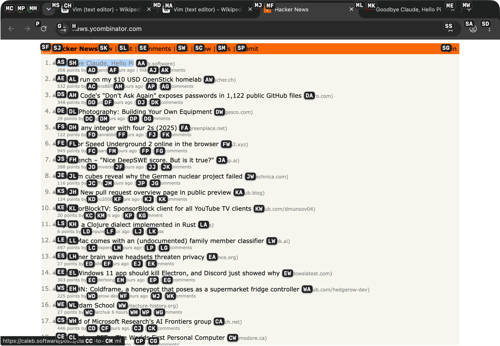
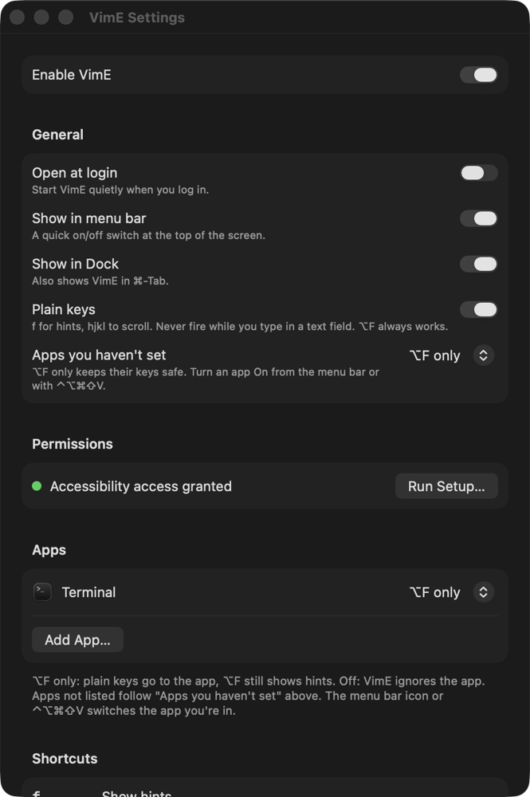

# VimE — vim everywhere

> **Work in progress.** This is a personal project, not a finished product. Things break, features are
> half-done, and behaviour changes between builds. There is no signed release yet; you build it
> yourself. See [Status](#status) for what is and isn't tested.

Vimium C-style keyboard control for macOS, outside the browser too. Press `⌥F` in any app and every
button, link, tab and menu gets a short label; type the label to click it. Scroll with `hjkl`. It
works through the macOS Accessibility API, so there's no browser extension and no per-app plugin.

Today it works in native apps (Finder, System Settings, Calculator…) and in Chrome, including web
pages. Electron apps (VS Code, Discord, Notion, Obsidian) and Safari are supported in code but not
tested yet; see [Status](#status).



*Chrome shown here. Screenshots of a native app and an Electron app are still to come.*

## Keys

| Key | Does |
| --- | --- |
| `⌥F` | Show hint labels on everything clickable, in any app, even while typing |
| `f` | Same, in apps you've switched **On** (outside text fields) |
| `j` `k` | Scroll down / up (hold to glide) |
| `h` `l` | Scroll left / right |
| `d` `u` | Half page down / up |
| `gg` `G` | Top / bottom |
| `?` | Cheat sheet (where plain keys are on) |
| `Esc` | Leave the text field you're typing in (web pages and Electron apps, where plain keys are on) |
| `⌃⌥⌘V` | Turn VimE on or off everywhere |
| `⌃⌥⌘⇧V` | Switch the app you're in: On → ⌥F only → Off |

While hints are showing: type a label to click it. Hold `⇧` on the last letter to right-click, or
`⌘` to ⌘-click (opens links in a new tab). `⌫` undoes a letter, `Esc` cancels.

Plain keys never fire while you type in a text field. Hints cover the focused window and the menu
bar (including open menus), and skip anything scrolled out of view, clipped, disabled, or in an
auto-hidden menu bar.

## Per-app rules

Each app is one of:

- **On**: plain keys (`f`, `hjkl`, `gg`…) outside text fields, plus `⌥F`.
- **⌥F only**: every plain key goes to the app; `⌥F` still shows hints.
- **Off**: VimE ignores the app entirely.

Plain keys are opt-in: apps you haven't set get **⌥F only**, so games, editors and anything else with
its own single-key shortcuts keep working. Turn an app On from the menu bar icon, with `⌃⌥⌘⇧V`, or in
Settings → Apps. "Apps you haven't set" in Settings changes that default. Terminals (Terminal, iTerm2,
Ghostty, kitty, Alacritty, Warp) are Off out of the box, since `⌥F` is "forward word" in shells; Vim
GUIs (MacVim, VimR) are ⌥F only.

Each app can also override per-app options from the menu bar icon or the ⋯ button in Settings → Apps.
For now there's one: **Esc leaves text fields** (on by default). In an app that's On, Esc in a text
field on a web page or in an Electron app (T3 Code, Slack, VS Code…) moves focus to the page, so plain
keys work again; Esc anywhere else still goes to the app. Turn it off for apps whose fields use Esc
themselves. Native Mac apps always keep their own Esc.



## Status

Builds for macOS 14 and later; only tested on macOS 26 (Apple silicon).

Works, tested by hand:

- Hints in native apps (Finder, System Settings…) and Chrome, including the web page.
- Scrolling, cheat sheet, per-app rules, menu bar switch, setup flow.
- 48 unit tests for the core logic (`make test`).

Built but not yet tried by hand: the `⌃⌥⌘V` / `⌃⌥⌘⇧V` shortcuts and their on-screen message, and the
opt-in default.

Not tested yet: VS Code, Discord, Notion, Obsidian, Safari, multiple displays, full-screen apps.

Known issues:

- In Chrome, links hidden with `opacity: 0`, `clip-path`, `transform: scale(0)`, or covered by another
  element still get hints. Chrome reports them to Accessibility clients exactly like visible links.
- No Developer ID signing or notarization, so other Macs need right-click → Open the first time.
- `⌥F` and `⌃⌥⌘V` match the key in the US-layout position of F and V, so on other layouts they may
  sit on a different letter. Plain keys (`f`, `hjkl`…) follow the typed character.

Ideas: a mode indicator (Normal / Insert / Hint) with a choice of where it sits, a sticky Insert mode
on `i`, detecting games and turning VimE off in them.

## Install

Requires macOS 14+, Xcode, and XcodeGen (`brew install xcodegen`).

```sh
git clone https://github.com/Dricmoy/VimE.git && cd VimE
make setup    # once per Mac: a local signing identity, then a Release build into /Applications
```

On first launch the setup window walks through granting Accessibility access. That permission is
all VimE needs; nothing leaves your Mac.

To get the latest version later:

```sh
make update   # git pull, rebuild and reinstall; settings and the Accessibility permission are kept
```

Using VimE on more than one Mac: run `make setup` on each, then copy your app rules across with
Settings → Other Macs → Export… and Import… on the other Mac.

Other targets:

```sh
make install  # rebuild and reinstall without pulling
make test     # unit tests for VimECore
make run      # build and launch from the build folder
make dmg      # build.noindex/VimE.dmg, drag-to-Applications installer
make icon     # redraw VimE/AppIcon.icns from scripts/make-icon.swift
```

Without the signing identity (`make signing`, part of `make setup`), builds are ad-hoc signed and
macOS forgets the Accessibility permission on every rebuild. The .dmg is signed with the same local
identity, not an Apple Developer ID, so on another Mac macOS blocks the first open: allow it in
System Settings → Privacy & Security → Open Anyway. Building on each Mac with `make setup` avoids
that.

## Troubleshooting

- **Nothing happens, or Settings says access is needed.** A rebuild with a different signature leaves
  a stale entry in System Settings → Privacy & Security → Accessibility. Open VimE → Settings → Run
  Setup… → Reset Permission, then allow it again.
- **Plain keys do nothing in an app.** That app is ⌥F only (the default). Turn it On from the menu
  bar icon or with `⌃⌥⌘⇧V`.
- **A browser's windows animate slowly.** A side effect of the Chromium Accessibility switch; see
  the notes below.
- **Uninstall.** Quit from the menu bar icon, delete `/Applications/VimE.app`, and optionally run
  `tccutil reset Accessibility com.dric.VimE`.

## How it works

A menu bar app with three parts:

1. A session-wide `CGEventTap` sees every key-down and decides, per key, whether VimE acts on it
   or lets it through (`VimECore/KeyRouter.swift`).
2. On `f` / `⌥F`, it walks the frontmost app's Accessibility tree off the main thread and keeps the
   elements a person could click (`VimECore/HintRules.swift`, `VimE/Accessibility.swift`).
3. Labels are drawn in a transparent, click-through panel that never takes focus
   (`VimE/Overlay.swift`). Typing a label presses the element through Accessibility, or clicks
   its center when it has no press action.

Notes:

- Chromium browsers (Chrome, Brave, Edge, Arc) only expose web pages to Accessibility clients that
  set `AXEnhancedUserInterface`, which VimE does when one comes to the front. Some window managers
  animate that browser's windows more slowly while it's set. Electron apps get the lighter
  `AXManualAccessibility`.
- Scrolling sends continuous (trackpad-style) scroll events at 120 per second: a held `j`/`k`/`h`/`l`
  glides and speeds up until you let go, a tap moves one step, `d`/`u` ease through half a page.
  Events go to the window's main scroll area. When the pointer is already over it, it stays put;
  otherwise it's moved there for the scroll and put back, because macOS only delivers scroll events
  through the pointer's position.

## Debugging

- `/usr/bin/log stream --level debug --predicate 'subsystem == "com.dric.VimE"'` shows each key VimE
  acts on and how long hint lookups take.
- Debug builds can list the hints VimE would show in an app without pressing anything:

  ```sh
  make build
  open -n -g -W build.noindex/Build/Products/Debug/VimE.app --args --dump-hints <pid> /tmp/hints.txt
  ```

  Add `--attrs` for every Accessibility attribute of each target. `--dump-focus <pid> <file> <seconds>`
  samples what the app reports as focused, and `--dump-pointer <file>` which app is under the pointer.
  Debug builds use their own bundle ID (`com.dric.VimE.debug`), so they don't share the installed app's
  Accessibility permission: grant it separately to use these.

## Layout

- `VimECore/`: pure logic, unit tested. Key routing and modes, hint labels and sessions, which
  elements get hints (`HintRules`), menu bar visibility, scrolling math, per-app rules, geometry.
- `VimE/`: macOS glue. Event tap, Accessibility tree walk, overlay panels, cheat sheet, toast,
  menu bar, setup and Settings.
- `VimECoreTests/`: XCTest suite for `VimECore`.
- `scripts/`: signing, .dmg and icon scripts used by the Makefile.

## Credits

Inspired by [Vimium C](https://github.com/gdh1995/vimium-c) and [Vimium](https://github.com/philc/vimium);
the hint label algorithm and alphabet follow Vimium's.

## License

MIT, see [LICENSE](LICENSE). This is a one-person project; please open an issue before a large PR.
